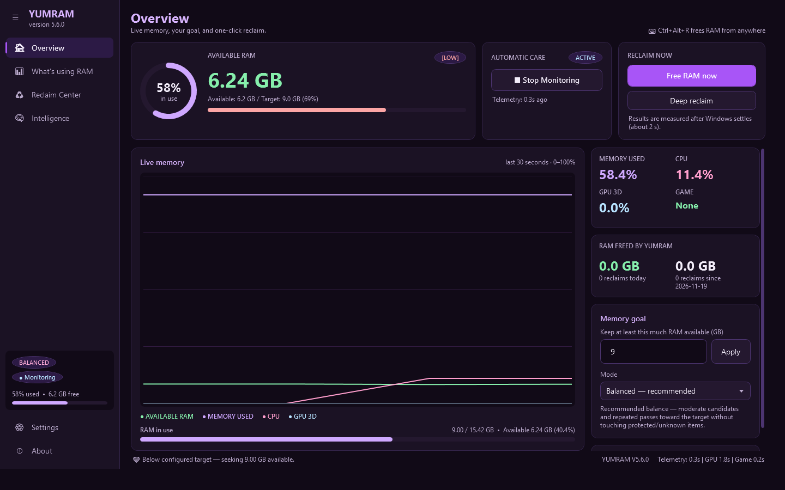
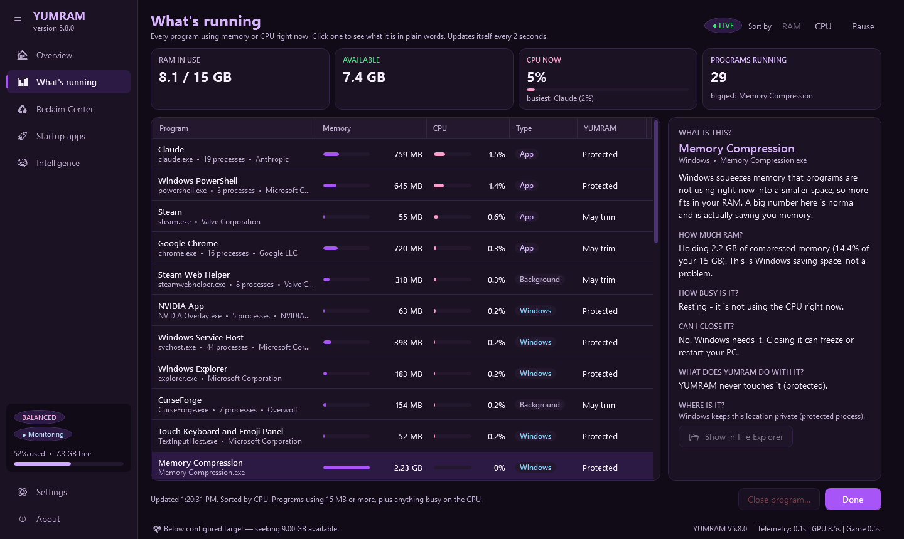
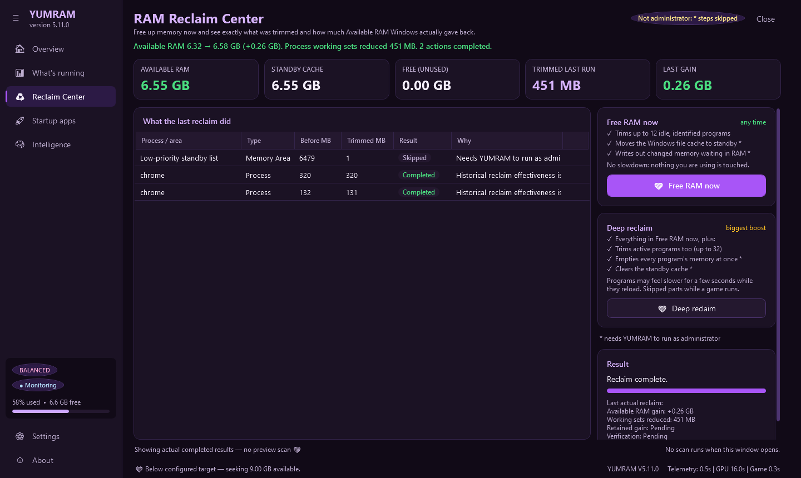
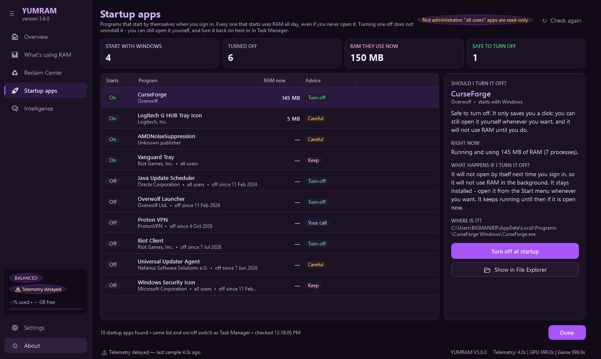
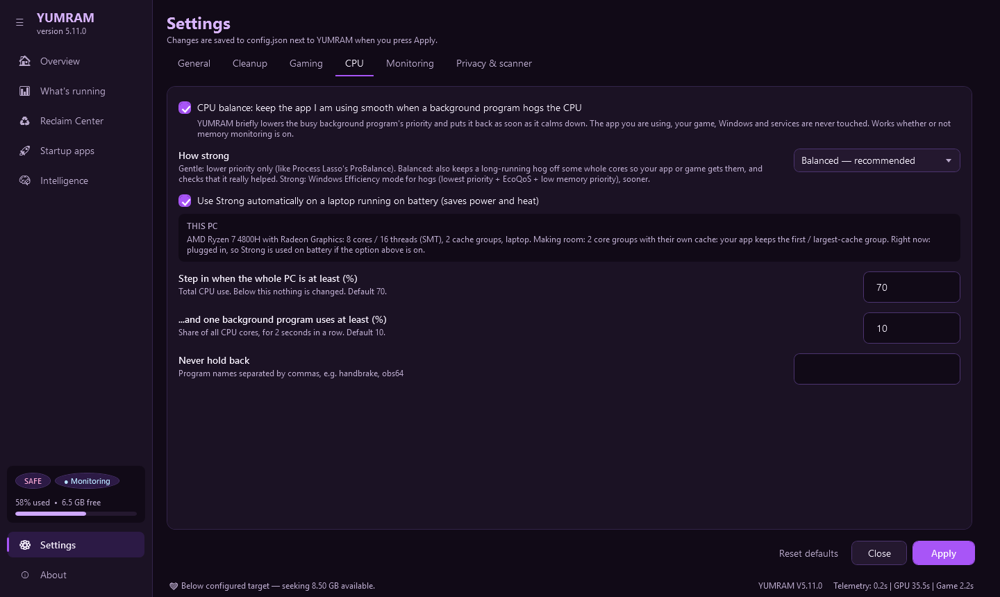

<div align="center">

# YUMRAM

**Keeps your Windows PC fast by keeping RAM free and the CPU fair — automatically.**

[](CHANGELOG.md)
[](#requirements)
[](#status)

[Download](https://github.com/bigmanjer/YumRam/releases/latest) · [What's new](CHANGELOG.md) · [How it works](#how-it-works) · [FAQ](#faq)



</div>

## Why YUMRAM

Most "RAM cleaners" flush everything and show a big number. YUMRAM is different:

- **It keeps a goal, not a gimmick.** You say how much RAM should stay available; YUMRAM keeps it
  there by trimming only idle, identified programs — never what you are using, never your game.
- **It measures, honestly.** Every result is the Available RAM Windows really gave back, checked again
  after 5, 15 and 30 seconds. It learns what works on *your* PC.
- **It handles the CPU too.** When a background program hogs the CPU, the app or game you are using
  gets priority and whole cores — and YUMRAM checks that it actually helped.
- **It explains things in plain words.** Every program, startup item and setting says what it is and
  whether it is safe to touch.

## Features

| | |
|---|---|
| **Automatic care** | Keeps Available RAM above your goal with small, paced trims; backs off when the goal is out of reach. |
| **Free RAM now / Deep reclaim** | One click or <kbd>Ctrl</kbd>+<kbd>Alt</kbd>+<kbd>R</kbd> from anywhere. Deep also empties memory lists and merges identical pages. |
| **CPU care** | ProBalance-style priority, plus *making room* on whole cores for your app or game. Adapts to your CPU (cores, SMT, efficiency cores, cache groups), laptop or desktop, battery or plugged in. |
| **What's running** | Live RAM and CPU per program, sortable, explained in plain words, with your own rules (*never trim*, *never hold back*). |
| **Memory-leak alerts** | Spots a program whose memory keeps rising and tells you once — restarting it gives the memory back. |
| **Windows bloat** | Removes preinstalled apps you do not need (News, Clipchamp, Solitaire, promoted games…) and turns off Windows ads, tips, suggestions, Bing in Start search, Copilot and Recall. Store, Edge, Windows Update and Defender are never touched; every change can be undone. |
| **Startup apps** | What starts with Windows, what it costs in RAM, and safe on/off using the same switch as Task Manager. |
| **Intelligence** | Identifies every process, service and app (signatures, installed-software records, services, Store packages, optional web lookup). Only identified, non-protected programs are ever trimmed. |
| **History** | Usage graph for 30 s, 5 min, 1 h and 12 h, kept across restarts. |
| **Tray & updates** | Lives in the tray with live RAM %, low-RAM and leak notices; checks GitHub for updates and installs them verified. |

<details>
<summary><b>More screenshots</b></summary>

| What's running | Reclaim Center |
|---|---|
|  |  |
| **Startup apps** | **CPU settings** |
|  |  |

</details>

## Install

1. Download **`YUMRAM-Setup-<version>.exe`** from [Releases](https://github.com/bigmanjer/YumRam/releases/latest).
2. Run it. It installs for your user only (no administrator needed), adds YUMRAM to the Start menu and
   to **Settings › Apps** (where you can uninstall it).
3. Set your memory goal on the Overview and press **Start Monitoring**.

> The installer is not code-signed yet, so Windows SmartScreen may say *"Windows protected your PC"*.
> Choose **More info › Run anyway**. Every release lists SHA-256 checksums in `SHA256SUMS.txt`.

**Administrator rights** make the strongest reclaim possible (file cache, memory lists, memory
combining). In **Settings › General › Administrator rights** choose *Ask each time*, *Start without
asking* (set up once; no prompt after that) or *Never*.

**Portable:** prefer no installer? Download the `.zip`, extract anywhere and run `YUMRAM.exe`.

## How it works

| | |
|---|---|
| **Trim, don't kill** | Trimming asks Windows to move a program's idle pages out of RAM. Nothing is closed and nothing is lost; the program pages back in what it needs. |
| **Available vs Free** | Available = Free + Standby cache. Deep reclaim empties the cache, so Windows' *Free* jumps by GBs — YUMRAM reports the real Available gain and tells you the difference. |
| **CPU care** | Gentle = Below Normal priority for a background hog. Balanced = also keeps it off some whole cores while you use an app (games: within 1 s) and undoes that if your app did not get more CPU. Strong = Windows Efficiency mode (Idle priority + EcoQoS). Everything is undone when the program calms down. |
| **Never touched** | Windows core processes, security software, drivers, your game, the window you are using, anything unidentified. |

Measured on a Ryzen 7 4800H laptop: a simulated 8-thread game next to a 32-thread background hog ran at
**11 FPS** with nothing, **131–135 FPS** with priority alone and **147–152 FPS** with CPU care Balanced
(153 FPS without the hog). Details in the [changelog](CHANGELOG.md).

## Modes

| Mode | What it may trim | Programs per pass |
|---|---|---|
| **Safe** | Identified, low-risk idle programs | up to 6 |
| **Balanced** (default) | Safe + programs with a valid publisher signature | up to 10 |
| **Aggressive** | Balanced + other identified programs | up to 16 |

## Privacy

- No account, no telemetry. Settings, statistics and learned data stay in the YUMRAM folder.
- **Online research** (on by default, Settings › Privacy): only the name, publisher and product of a
  program YUMRAM cannot identify locally is sent to Bing search; up to 4 trustworthy result pages (e.g. the publisher's site) are then opened to check the answer.
- **Update check** (once a day, can be turned off): one request to GitHub's public releases API.
- **Community game results** ([details](Docs/COMMUNITY.md)): sharing your game benchmark results is **off unless you turn it on**, and you see the exact text first (CPU model, laptop/desktop, Windows build, frame rates of YUMRAM's test game - nothing else). Using other people's results for your CPU downloads a public file once a week and sends nothing about you.

## Requirements

- Windows 10 or 11, 64-bit
- Windows PowerShell 5.1 and .NET Framework 4.x — both built into Windows; nothing to install

## FAQ

<details><summary><b>Is trimming RAM safe? Will my programs lose data?</b></summary>
Yes, it is safe, and no data is lost. Trimmed pages stay on disk or in the standby list and come back
when the program needs them. Programs you are using and your game are never trimmed.
</details>

<details><summary><b>Why does Windows' "Free" memory jump more than YUMRAM reports?</b></summary>
Deep reclaim empties the standby cache, which moves it to <i>Free</i>. That cache already counted as
<i>Available</i>, so it is not extra room. YUMRAM reports the real Available gain.
</details>

<details><summary><b>My goal says "Out of reach".</b></summary>
Your goal is higher than this PC can free right now without closing programs. Lower it, close apps, or
use Aggressive mode. YUMRAM keeps trying with a back-off instead of hammering the system.
</details>

<details><summary><b>Does CPU care conflict with anti-cheat?</b></summary>
No. YUMRAM never touches the game process; it only lowers background programs.
</details>

<details><summary><b>Something went wrong.</b></summary>
Open <b>About › Log</b> (or <code>YUMRAM.log</code> in the YUMRAM folder) and
<a href="https://github.com/bigmanjer/YumRam/issues/new/choose">open an issue</a> with the last lines.
</details>

## Development

```powershell
powershell -NoProfile -ExecutionPolicy Bypass -File Tests\Run-AllTests.ps1     # 54 tests, each in its own process
powershell -NoProfile -ExecutionPolicy Bypass -STA -File Tests\UI\FullUiProbe.ps1 -Root . -Out $env:TEMP\yum-ui
powershell -NoProfile -ExecutionPolicy Bypass -File Tools\Build-Release.ps1    # dist\: setup, zip, SHA256SUMS
```

```text
App/        entry point and module bootstrap        Launcher/   YUMRAM.exe and the installer (C#)
Core/       memory engine, CPU care, safety,        UI/         WPF pages (XAML) and their code
            intelligence, research, telemetry       Tools/      build scripts
Config/     shipped defaults                        Tests/      test suite + full UI probe
```

See [CONTRIBUTING.md](CONTRIBUTING.md) and [Docs/ARCHITECTURE.md](Docs/ARCHITECTURE.md).

## Status

YUMRAM is **beta** software: feature-complete for everyday use and tested on real hardware. Please report anything odd with **About › Report a problem**.
No license has been chosen yet, so all rights are reserved by the YUMRAM contributors — you may read
the code, but please ask before reusing or redistributing it.
